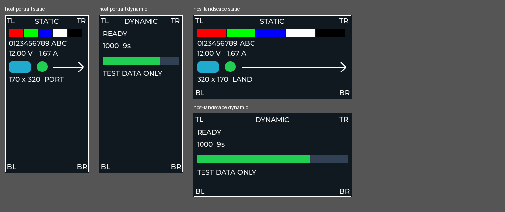

# 验证记录（2026-11-06）

## 软件构建

使用 MRS3 WCH GCC12 (riscv-wch-elf-gcc 12.2.0)。独立 build.py 每个方向构建 V3 44 个源文件、V5 340 个源文件；全部编译和链接成功。未运行下载、复位或在线调试。

| 方向 | V5 text | V5 data | V5 bss |
|---|---:|---:|---:|
| 竖屏 170×320 | 116228 | 17244 | 78452 |
| 横屏 320×170 | 116228 | 17244 | 87452 |

V3 两种构建均为 text=2900、data=80、bss=2060。两方向 V5 bss 相差9000B，符合两块绘图缓冲加一块转换缓冲从170×10×2增至320×10×2。每个方向都校验 V3 镜像小于64KB、合并偏移和两个镜像内容一致。ELF/map/bin/hex/日志及编译器信息在 build/<orientation>/ 下（不提交到Git）。供应商库保留原有注释/未用参数等警告；新代码的隐式函数声明视为构建错误。

## 主机 LVGL 验证

MinGW GCC 编译同一份 LVGL、自检模块和 tests/render_ui.c。两个方向均通过：

- 每次 flush 范围落在对应分辨率内。
- 重复 start 后只有一个自检根对象，重复 stop 可恢复原有对象数量。
- 执行约69.5秒模拟tick，包括多个整页切换、动态文字与进度条。
- 实际渲染静态/动态图片，人工检查四边、四角、文字和箭头完整。

主机渲染直接接收 LVGL RGB565 缓冲，绕过 LCD、SPI、DMA 和 MADCTL。通过此项不能宣称横屏实物偏移、总线字节序、DMA可靠性、帧率或真实非阻塞性能已验证。

## 待用户上板验收

分别下载对应方向的最新 Merge.bin，并冷启动。观察60秒：四边/四角齐全、方向正确、RGB颜色正确、无花屏或残影，静态与动态页每8秒切换。两种方向均需完成。当前没有上板结果。
